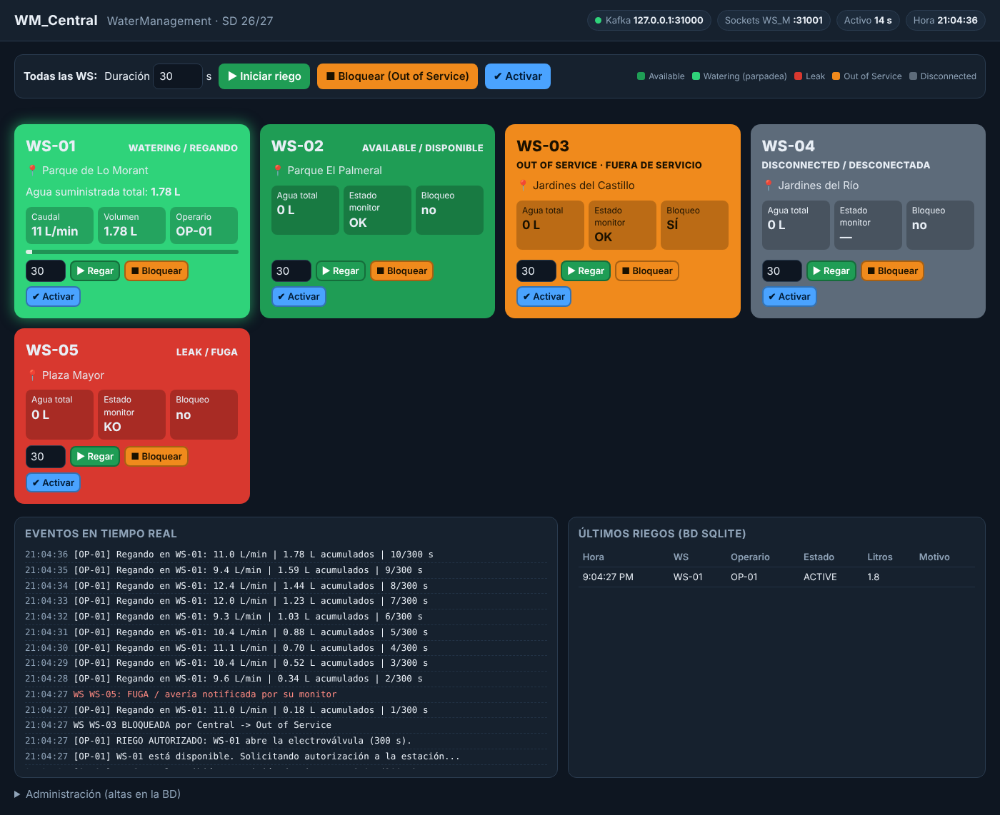

# Memoria de la práctica · WaterManagement (Release 1)

**Sistemas Distribuidos · Curso 2026/27**

| | |
|---|---|
| Estudiante(s) | `<Nombre y apellidos>` · `<DNI>` (hasta 2 personas) |
| Grupo de prácticas | `<…>` |
| Repositorio | `https://github.com/<usuario>/UA_SD` (acceso concedido al profesor) |
| Panel de Central (Railway) | `https://<dominio>.up.railway.app` |

> Entrega por UACloud en la semana del 26 de octubre de 2026, con el código fuente y esta memoria.
> *Rellena lo marcado con `<…>` y sustituye las capturas de ejemplo por las de tu despliegue real.*

---
## 1. Introducción
Sistema distribuido que simula la gestión centralizada del riego de parques y jardines: una **central** monitoriza y
controla **estaciones de riego (WS)** y atiende las peticiones de los **operarios de campo (FO)**. Se combinan
**sockets** (latido y salud, con tramas `<STX>D<ETX><LRC>`) y **streaming de eventos con Kafka** (peticiones, órdenes,
telemetría y notificaciones), con una base de datos **SQLite** en la central.

## 2. Arquitectura
Ver diagrama del `Readme.md`. Despliegue: **Railway** (WM_Central, Kafka, SQLite) · **PC LAB 1** (WM_FO) · **PC LAB 2**
(WM_WS: Monitor + Engine). Todos los módulos en **Docker**; ciclo **VS Code → GitHub → Railway**.

| Componente | Lenguaje | Comunicación |
|---|---|---|
| WM_Central | Python 3.12 | Servidor de sockets concurrente (monitores) · Kafka · SQLite · HTTP (panel) |
| WM_WS_M (Monitor) | Python | Cliente de sockets hacia Central · servidor de sockets para su Engine |
| WM_WS_E (Engine) | Python | Cliente de sockets hacia su Monitor · Kafka |
| WM_FO | Python | Kafka |

## 3. Componentes desarrollados
Cada uno con su fichero principal y parámetros (tabla completa en el `Readme.md`).

* **WM_Central** (`WM_Central/WM_Central.py`, `central_db.py`, `central_web.py`, `panel.html`): al (re)iniciar carga de SQLite las
  WS registradas y las muestra *Desconectadas*; autentica/registra monitores; valida y autoriza riegos; ordena
  iniciar/bloquear/activar a una o todas las WS; publica el estado; panel web con los cinco estados y colores.
* **WM_WS_M** (`WM_WS/WM_WS_M.py`): se autentica en Central, envía `HB` cada segundo, comprueba la salud del Engine con
  `PING` cada segundo y notifica la fuga si no responde o responde KO.
* **WM_WS_E** (`WM_WS/WM_WS_E.py`): simula caudalímetro y electroválvula; riego con telemetría cada segundo; tecla `k` simula KO;
  tecla `r` riego manual; persiste el riego en disco y entrega el resumen final aunque haya caídas.
* **WM_FO** (`WM_FO/WM_FO.py`): solicita riegos (manual o desde fichero, con 4 s entre servicios), ve todas las WS y
  recibe solo los mensajes de sus peticiones.
* **Librería común** (`shared/wm_common.py`): tramas con LRC y capa Kafka.

### Base de datos (SQLite)
`operators(id, name)` · `watering_stations(id, location, blocked, total_liters, registered_at)` ·
`sessions(req_id, ws_id, operator_id, source, duration, started_at, ended_at, volume, reason, status, created_at)`.

## 4. Protocolos
**Sockets**: `<STX> DATA <ETX> <LRC>`, `LRC = XOR(DATA)`, respuesta `<ACK>`/`<NACK>` con retransmisión (3 intentos);
`DATA = OPERACIÓN#campo1#…`. Mensajes y topics de Kafka: tablas del `Readme.md`.

Estados y colores: Available (verde) · Watering (verde parpadeante, caudal, volumen, operario) · Leak (rojo) ·
Out of Service (naranja) · Disconnected (gris).

| Monitor | Engine | Estado en Central |
|---|---|---|
| OK | OK | Available (verde) |
| OK | KO / caído | Leak (rojo) |
| KO / caído | cualquiera | Disconnected (gris) |

## 5. Guía de despliegue
Copia de `docs/DESPLIEGUE.md` (es la misma que se usará el día de la corrección). `<Pega aquí los pasos o enlaza>`.

## 6. Pruebas y resultados
Batería automática `tests/test_scenarios.py` (procesos reales de todos los módulos + broker Kafka de prueba).
Resultado de la última ejecución: **11/11 escenarios superados**.

| Escenario | Qué verifica |
|---|---|
| `protocol` | LRC correcto/erróneo → ACK/NACK → retransmisión |
| `basic` | Registro/autenticación, denegaciones, filtrado de mensajes por operario, BD |
| `leak` | Engine KO → rojo, fin inmediato del riego, recuperación y estado final |
| `block` | Bloquear/activar una o todas, riego desde Central |
| `moncrash` / `monrestart` | Cae un Monitor: gris, riego finaliza, WS «Averiada»; recuperación sin reiniciar el Engine |
| `engine` | Cae un Engine en pleno riego: rojo; al volver informa del volumen final (no se pierde lo regado) |
| `fo` | Se cierra un FO: el riego sigue y al volver ve el resultado |
| `central` | Cae Central: las WS acaban el riego, «Imposible conectar con WM_Central»; al volver se recupera todo y se procesa el resumen pendiente |
| `file` | FO lee un fichero; espera 4 s entre servicios |
| `manual` | Riego manual desde el menú de la WS |

> **Limitación declarada:** las pruebas automáticas usan un broker de prueba que implementa la API de `confluent-kafka`
> usada por la práctica; la validación contra Kafka real y Railway se hace en el despliegue (apartado 5).

## 7. Capturas de pantalla
Sustituye por capturas de tu despliegue real (Central en Railway, WS y FO en el laboratorio):

1. Panel de Central tras arrancar (todas *Disconnected*).
2. Monitor y Engine autenticados; WS en verde.
3. FO solicitando un riego y mensajes de cada paso; panel con la WS *regando* (verde parpadeante).
4. Estados Leak (rojo), Out of Service (naranja), Disconnected (gris).
5. Pruebas de caída (Monitor, Engine, FO, Central).
6. Railway: servicios, volumen, TCP Proxy y despliegue por `git push`.

Ejemplo (entorno de pruebas local, con los cinco estados a la vez):

## 8. Uso de la IA
Se ha usado Claude como apoyo; los prompts están en `prompts/prompts.md`. Los autores comprenden y pueden explicar
el código (`docs/EXPLICACION_CODIGO.md`).

## 9. Conclusiones y trabajo futuro
`<Dificultades, decisiones de diseño, mejoras: dos centrales, dos brokers, TLS en sockets, …>`
